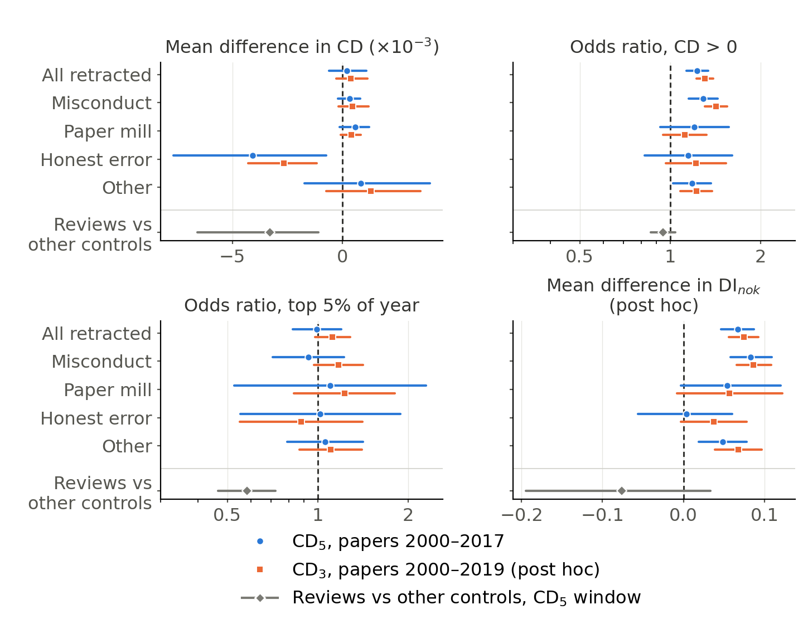
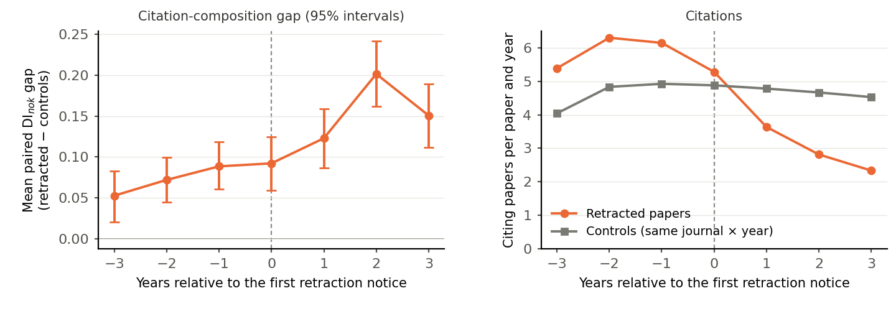

<h1 align="center">Do retracted papers look disruptive?</h1>

<p align="center">
  <em>The CD index before retraction on the open biomedical citation graph</em>
</p>

<p align="center">
  
  
  
  
  
</p>

Companion repository to the paper by **Hossein Mohasel Arjomandi** (manuscript prepared for submission). It holds
the code, the design specification and the post hoc plans with their hashes, every run record with checksums, a map
from each number in the paper to the run that produced it, and the LaTeX source.

## In one paragraph

The CD index of disruption is widely used, and its use in research evaluation is being discussed. This project asks how
it scores papers that are **later retracted**. Scores are computed on the **January 2024** OpenCitations graph (linked
to PubMed) for biomedical papers published 2000–2017 that were retracted only **after** their five-year scoring window
closed, and for never-retracted controls from the **same journal and year**. The design was specified before any score
was computed; the scores were **frozen with a hash** before retraction labels were joined. Analyses added later are
labelled post hoc, and each plan was written down before it was run.

## Results at a glance

| | |
|---|---|
| Retracted papers scored before their retraction | **4,587** |
| Primary comparison: retracted papers / scored controls / journal-year strata | **4,586** / **31,662** / **2,239** |
| Mean difference in CD5 (retracted − controls) | **0.0002** (95% CI −0.0006 to 0.0011) |
| Interpretable mean-difference bound (post hoc 90% interval) | Absolute differences above **0.00093** excluded, about 28% of the review effect |
| Odds ratio for a positive CD5 (pre-specified RQ1) | **1.23** (1.13–1.34) |
| Odds ratio for reaching the top 5% of the year | **0.99** (0.83–1.20) |
| Positive control: reviews vs other papers, top 5% | 0.58 (0.47–0.72): the design detects a real contrast |
| Variant without n_k (DI_nok): retracted − controls (post hoc) | **+0.067** (0.046–0.087): their citing papers less often cite their references |
| Top 5% at equal reference length (post hoc) | 1.42 (1.16–1.75) |
| Matched difference in mean log(1 + references), P12 | **+0.084** (0.058–0.109), 4,586 retracted papers / 31,662 controls |
| Article-type sensitivity, CD5 top 5% (P13) | 1.07 (0.86-1.33), 3,521 compared retracted papers / 23,839 controls |
| Article-type sensitivity, reference-adjusted CD5 top 5% | 1.64 (1.28-2.10); matched mean-log reference gap +0.064 (0.045-0.083) |
| Article-type sensitivity, CD3 top 5% | 1.21 (1.04-1.42), 5,592 compared retracted papers / 37,334 controls |
| Author-name exclusion (P14), five-year DI_nok | +0.061 (0.038-0.084), 2,260 compared papers; 2,280 primary papers removed |
| Author-name exclusion (P14), three-year top 5% | 1.03 (0.85-1.25), 3,626 compared papers |
| Size of n_k for the median paper | 2,862 papers citing only the references vs 12 citing the paper |
| Change in DI_nok after vs before the notice, minus controls (post hoc) | +0.074 (0.050–0.097); placebo 3 years earlier +0.036 |

**Take-away:** the pre-specified five-year analysis shows a small positive-score shift but no unadjusted top-tier
excess; the post hoc three-year window leans toward a modest excess, but this weakens under author-name exclusions.
The citation-composition contrast persists after that exclusion. Article-type restriction retains the reference
imbalance and adjusted excess, but is an operational proxy, not a guarantee of original research.
The n_k term compresses the citation-composition gap, and scores including post-retraction years are shifted. Every
number above is traced in [`FINDINGS.md`](FINDINGS.md). Mean-log reference gaps describe the direction of imbalance,
not the magnitude of the adjusted odds-ratio shifts. P14 uses name strings, not disambiguated author identities.

The full pool of 52,147 controls was drawn for all 10,450 retracted papers, including those retracted inside their
window. Of these controls, 25 have an undefined CD5 because its denominator is zero, leaving 52,122 scored controls.
The primary comparison uses only the 31,662 scored controls in strata containing scored primary-set papers.

<p align="center">
  
</p>
<p align="center">
  
</p>

## What is in here

```text
.
├── README.md            ← you are here
├── SPEC.md              pre-specified design (v1; its SHA-256 is in every run.json)
├── POSTHOC.md           post hoc plans P1–P14, each written before it was run
├── FINDINGS.md          every number in the paper → the run that produced it
├── REPRODUCE.md         inputs, environment, exact commands in order, determinism notes
├── CITATION.cff         how to cite this repository
├── experiments/
│   ├── README.md        index of steps and the runs cited in the paper
│   ├── e01 … e14/       one folder per step: script(s), lab notebook RESULTS_LOG.md, runs/<run_id>/
│   └── …/runs/<id>/     run.json (parameters, script hash, counts) · stdout.log · group-level outputs · SHA256SUMS
├── paper/               LaTeX source (content/, journals/joi/main.tex), figures, refs.bib + DOI checks
├── lit/                 literature gate, verified DOIs and the claim check
└── vm/                  scripts and environment for the large-machine steps
```

## Quick start

```bash
# 1. verify every run record against its checksums
ok=1; for d in experiments/*/runs/*/; do (cd "$d" && sha256sum -c --quiet SHA256SUMS) || ok=0; done; [ $ok = 1 ] && echo "all runs OK"

# 2. unit tests (need duckdb, pandas): CD counts and yearly counts against brute force
cd experiments/e03_cd5 && python test_cd.py && cd ../e07_yearly && python test_yearly.py && cd ../..
python experiments/e13_article_types/test_sensitivity.py
python experiments/e14_authors/test_authors.py

# 3. rebuild the figures from the run records (byte-identical to the committed ones with Matplotlib 3.10.8)
cd experiments/e06_figures && python e06_figs_v2.py my_rebuild e04_eval_20261110_01 e04_eval_cd3_20261110_01 \
   e08_posthoc2_20261123_02 e09_pretrend_20261123_01 e12_diag_20261126_01 && \
   cmp runs/my_rebuild/fig1_forest.pdf ../../paper/figures/fig1_forest.pdf && \
   cmp runs/my_rebuild/fig2_event.pdf ../../paper/figures/fig2_event.pdf && cd ../..

# 4. build the paper (Tectonic or any LaTeX)
cd paper/journals/joi && tectonic -X compile main.tex
```

**Full pipeline:** about 64 GB RAM and under one machine-hour on top of the graph tables; see [`REPRODUCE.md`](REPRODUCE.md).

## Data sources

| Source | Used for | Access | Terms |
|---|---|---|---|
| Parsed OpenCitations snapshot, Jan 2024 | citation graph | Illinois Data Bank, [doi:10.13012/B2IDB-5216575_V1](https://doi.org/10.13012/B2IDB-5216575_V1) | CC BY 4.0 |
| OpenCitations Meta | DOIs, PMIDs, journals, years | figshare, [doi:10.6084/m9.figshare.21747461.v7](https://doi.org/10.6084/m9.figshare.21747461.v7) | CC0 |
| Retraction Watch database | retraction labels, dates, reasons | [gitlab.com/crossref/retraction-watch-data](https://gitlab.com/crossref/retraction-watch-data), commit `a98cc7e`; linked table [doi:10.5281/zenodo.23874477](https://doi.org/10.5281/zenodo.23874477) | see the source; please cite it |
| PubMed 2026 baseline | biomedical flag, reviews, notice records, article-type sensitivity | [NLM baseline files](https://ftp.ncbi.nlm.nih.gov/pubmed/baseline/) | courtesy of the U.S. National Library of Medicine |

## Rigour by design

- **Pre-specified.** [`SPEC.md`](SPEC.md) fixed populations, score, analyses and robustness checks before any score
  existed; its hash is recorded in every run. It was not deposited with a registry, so it is a pre-specification, not a
  formal pre-registration. The original repository and commit history remain private; the public release cannot
  resolve commit `293755b1`. [`experiments/spec_provenance.json`](experiments/spec_provenance.json) documents this.
- **Post hoc, but planned.** Each later analysis was written into [`POSTHOC.md`](POSTHOC.md) with its margins and
  expected directions before it was run; one rule was amended (and the affected runs redone) before its results were read.
- **Frozen scores.** Evaluation scripts check the hashes of the frozen score and count files before they read any label,
  and new evaluation scripts first reproduce the earlier estimates exactly.
- **Tested counting.** The disruption counts and the yearly counts are tested against brute-force counts on random graphs.
- **Nothing overwritten.** Every run gets its own folder; replaced runs keep a `SUPERSEDED.txt` explaining why.
- **Verified references.** References were checked through their DOI, publisher page or arXiv record
  ([`paper/bib_verification.tsv`](paper/bib_verification.tsv)).

## Responsible use

- No author names, and **no score, rank or list of non-retracted papers**; per-paper tables stay on the analysis machine.
- A retraction is a public editorial label; it does not by itself imply misconduct. All results are associations.

## Citation

Please cite the paper (details will be added on publication) and this repository; GitHub's *Cite this repository*
button uses [`CITATION.cff`](CITATION.cff).

## Licences

Code: [MIT](LICENSE). Run records, tables, figures and documentation: [CC BY 4.0](LICENSE-DATA). The input datasets
keep their own terms.

## Generative AI

Claude Opus 5.5 (Anthropic) was used as a coding and writing assistant under the author's direction; GitHub Copilot
(powered by GPT-6.1 Sol, OpenAI) was used to check and edit the manuscript before submission. The author
checked every analysis, number and reference.
